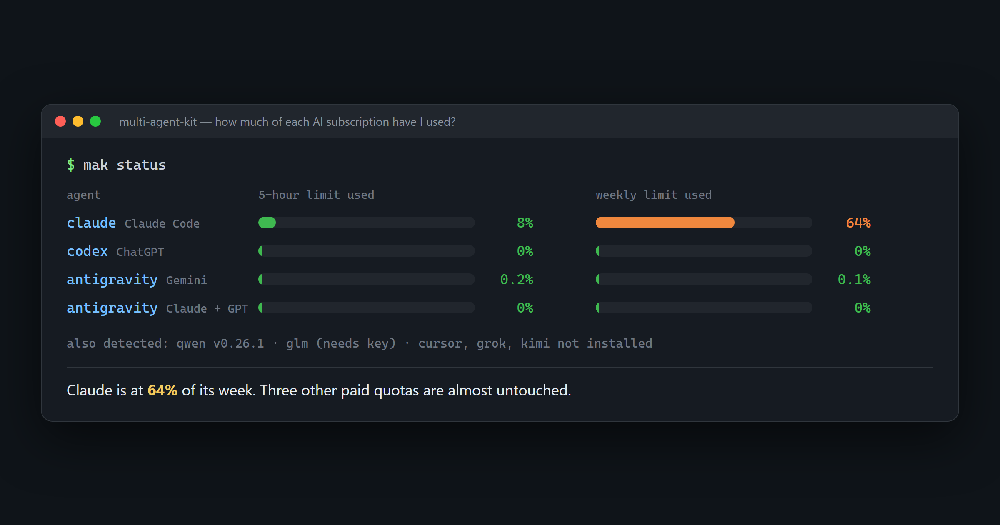
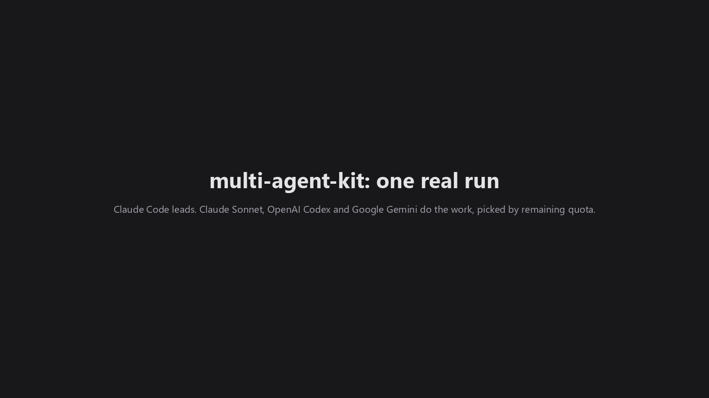

# multi-agent-kit

**Use every AI coding subscription you already pay for, not just one.**


*Animated from one real run on 2026-10-25, when Claude Code built this repo's `mak log` command this way. All numbers are from that run. [MP4 version](docs/images/mak-demo.mp4) · [real screen captures](#see-the-real-run).*

Many developers pay for more than one plan: Claude Max, ChatGPT Plus/Pro (Codex), Google AI Pro (Antigravity), Kimi, Qwen, Cursor, Grok, GLM... Each has its own 5-hour and weekly limit, and the unused part simply expires. Most of us work in one tool all day, so the others' quota is wasted.

multi-agent-kit makes **Claude Code the lead**, and gives it what it needs to spend all of that capacity well:

1. **A status report** of every coding CLI on the machine: installed, signed in, and how much quota is left with its reset time, where the CLI exposes it.
2. **Adapters**: one small JSON file per agent, describing how to find it, check it, read its limits, and run it headless.
3. **Rules** that tell Claude to check the report, pick the agent whose quota fits and would otherwise expire, delegate with a full brief, and verify the result.
4. **Shared roles** for Codex, Antigravity and the rest, so every agent follows the same worktree, review and merge rules.

There is no routing engine. Claude already has the judgment; the kit gives it the facts.

Real report from the maintainer's machine. Claude has used 64% of its week while Codex and Antigravity sit at almost 0%: that is the waste this kit exists to fix.



```text
$ node ~/.multi-agent-kit/bin/mak.mjs status
+ antigravity  v1.4.7   | not checked (use --deep) | gemini 7d 0.1% used, resets 10-31 06:09Z | gemini 5h 0.2% used | claude+gpt 7d 0% used | claude+gpt 5h 0% used
+ claude       v2.1.310 | signed in | 5h 8% used, resets 19:00Z | 7d 64% used, resets 10-27 11:00Z
+ codex        v0.164.0 | signed in | 5h 0% used, resets 18:02Z | 7d 0% used, resets 11-01 13:02Z
- cursor       not installed (adapter untested)
+ glm          v2.1.310 | ZAI_API_KEY not set | not exposed by this CLI
- grok         not installed (adapter untested)
- kimi         not installed (adapter untested)
+ qwen         v0.26.1  | unknown | not exposed by this CLI
```

## See the real run

The same run as the animation above, as real screen captures of the Claude Code app plus real `mak status`, `npm test` and `mak log` output:



## Supported agents

| Agent | Adapter | Limits readable | How |
|---|---|---|---|
| Claude Code | verified | ✅ 5h + 7d | the status line payload (`bin/statusline.mjs` saves it) |
| OpenAI Codex CLI | verified | ✅ 5h + weekly | `~/.codex/sessions` logs |
| Google Antigravity (`agy`) | verified | ✅ 5h + weekly, per model group | its interactive `/usage` screen, read through a pseudo-terminal (no model call, cached 15 min). Also exposed to Claude as the MCP tool `ask_antigravity` |
| Kimi Code | untested | ❌ | `kimi -p` |
| Qwen Code | untested | ❌ | `qwen -p` |
| Cursor CLI | untested | ❌ | `agent -p --mode=ask` |
| Grok Build | untested | ❌ | `grok -p` |
| GLM Coding Plan (Z.ai) | untested | ❌ | Claude Code pointed at Z.ai's Anthropic-compatible endpoint |

"Untested" means the maintainer has no subscription for it yet; the adapter follows the vendor's docs. **If you have one of these plans, please test it and send a PR** (see [CONTRIBUTING.md](CONTRIBUTING.md)).

## Install (Windows)

Needs Node 18+, PowerShell 7, and Claude Code. Sign in to whichever other CLIs you pay for first, following each one's own instructions (see the `install` field in its adapter).

```powershell
git clone https://github.com/anand-s-kale/multi-agent-kit
cd multi-agent-kit
pwsh -File .\install.ps1
```

Then start a new Claude Code session. Ask it things like "check which agents have quota and split this plan between them", or just work as usual: the rules make Claude consider delegating on its own.

Re-run `install.ps1` after pulling updates. It is idempotent.

macOS/Linux: `bin/mak.mjs` and the adapters are cross-platform, but the installer is PowerShell only for now. An `install.sh` is a welcome contribution.

## Delegation log

Claude records each delegation, with the agent's quota at dispatch time, so you can see where the work went:

```text
$ mak log add --agent codex --task "write tests for mak log"
$ mak log
#  time (UTC)        agent  model  quota at dispatch  task
1  2026-10-25 18:10  codex  -      5h 0% | 7d 0%      write tests for mak log
```

Pass `--json` for machine-readable output or `--limit N` to show more or fewer entries (default 20). The ledger lives in `~/.multi-agent-kit/usage/ledger.jsonl`.

## What gets installed

| From | To |
|---|---|
| `bin/`, `adapters/` | `~/.multi-agent-kit/` |
| `claude/rules/multi-agent.md` | `~/.claude/rules/` |
| `claude/agents/*.md` (`sonnet-builder`, `cross-model-reviewer`) | `~/.claude/agents/` |
| `codex/AGENTS.md` | a marked block in `~/.codex/AGENTS.md` |
| `antigravity/GEMINI.md` | a marked block in `~/.gemini/GEMINI.md` |
| `bridges/antigravity-claude-mcp-0.1.0/` | `~/.claude/mcp/` + user-scope MCP server `antigravity` |
| status line | `~/.claude/settings.json` `statusLine`, **only if you have none** |

## Good to know

- **Your own logins only.** The kit drives each vendor's official CLI with your own account or key. It never shares, proxies or reads credentials. Check each vendor's terms for automated use of your plan.
- **Codex ≥ 0.164 has no MCP server**, so Claude calls the Codex CLI directly. On Windows an older standalone `codex` may be first on PATH; `mak status` reports the right binary and flags outdated ones.
- **Antigravity bridge.** [`antigravity-claude-mcp`](https://github.com/arjunthilak05/antigravity-claude-mcp) 0.1.0 (MIT) is vendored and pinned, not pulled with `npx`, so upstream changes can't arrive unreviewed. It runs `agy` with permissions skipped, so the rules tell Claude to pass it only files it should read. The installer sets `AGY_BIN` (its Windows detection is broken) and `AGY_MODEL` (its default model isn't on every account).
- **Claude limits** appear after the status line has run once in a session. If you already have a custom status line, the installer leaves it alone; pipe its input through `bin/statusline.mjs --save-only` to record limits.

## Related projects

These solve neighbouring problems. The gap this kit fills is **deciding by quota across all of them**:
- [openai/codex-plugin-cc](https://github.com/openai/codex-plugin-cc): official Claude Code → Codex delegation and review
- [PAL MCP](https://github.com/BeehiveInnovations/pal-mcp-server): multi-model MCP server, CLI-to-CLI `clink`
- [Maestro](https://github.com/josstei/maestro-orchestrate): a workflow plugin inside each runtime
- [Vibe Kanban](https://www.vibekanban.com/): a board for running several agents in worktrees

More in [docs/consoles.md](docs/consoles.md).

## License

MIT, see [LICENSE](LICENSE). The vendored bridge keeps its own MIT license.
